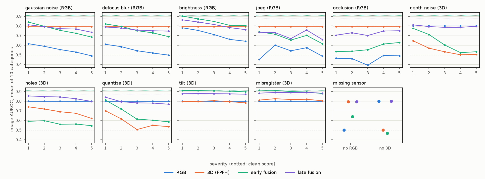

# FactoryLens

[](https://github.com/borabek/factorylens/actions/workflows/ci.yml) [](https://huggingface.co/spaces/bora2005/factorylens) [](https://doi.org/10.5281/zenodo.23764784)

Anomaly detection for industrial inspection using an RGB camera and a 3D sensor together, with a focus on what happens when one of the two sensors gets noisy or fails.

The write-up is a short paper in [paper/](paper/) (`make paper` builds it). The research question, the dataset decision and the hypotheses are in [docs/research_plan.md](docs/research_plan.md). How the inspector would sit on a real production line, and what is missing for that, is in [docs/architecture.md](docs/architecture.md).

## Results

**Reproducing Back to the Feature** (full tables in [docs/results.md](docs/results.md)), image AUROC averaged over the 10 categories:

| | this repo | published (Back to the Feature) |
|---|---|---|
| RGB only, PatchCore (5 seeds) | 0.799 ± 0.005 | 0.785 |
| 3D only, FPFH | 0.793 | 0.753 |
| RGB + FPFH concatenated, as in BTF (their preprocessing) | 0.801 | 0.873 |
| RGB + FPFH, halves balanced on the training data (their preprocessing) | **0.923** | |

- The two sensors fail in different places. RGB is near chance on potato (0.56), where 3D gets 0.95. 3D struggles on cable_gland and tire, where RGB is fine.
- Both single-sensor baselines reproduce. The published fusion does not: concatenating the two feature sets as BTF does lands *below* the better single sensor on 8 of 10 categories.
- The FPFH half of the joint features is 12–47 times wider than the RGB half, so the distances are almost entirely 3D. Rescaling it on the training data alone lifts the same fusion to 0.923, above both sensors on 9 of 10 categories and above the published number.

**How much normal data fusion needs** (990 runs: 4 detectors × k = 1, 5, 10, 50, all × 5 draws, this repo's preprocessing):


- On the full training set, balanced early fusion scores 0.910 and late fusion 0.876, against 0.800 for RGB and 0.793 for 3D. In 40 paired comparisons with a single sensor, fusion is never significantly worse.
- From 5 training images up, both fusions beat either sensor used everywhere. Against the harder baseline of picking the better sensor per category after the fact, late fusion matches it with all the data (0.876 vs 0.877) and early fusion beats it once there are 50 or more images (9 of 10 categories, Wilcoxon p = 0.04). Late fusion localises defects best (AUPRO 0.970).
- Early fusion is fragile with little data. At k ≤ 10 it drops more than 0.05 below the better sensor in a quarter of runs, sometimes below chance. On bagel this is because a few images don't hold the combinations of appearance and geometry a joint nearest neighbour needs. But that doesn't generalise: on cookie and peach, joint matching is clearly better than matching the two sensors separately, so a label-free coverage check can't pick the fusion in advance.

**When one sensor breaks** (FactoryLens-C: 10 corruptions × 5 severities and a missing sensor for each, 10 categories, details in [docs/corruptions.md](docs/corruptions.md)):



- Early fusion, the best model on clean data (0.910), is the most fragile. Averaged over severities it falls below the uncorrupted sensor on its own for 9 of 12 corruptions, and below chance (0.466) when the 3D sensor is missing.
- Late fusion survives a dead sensor at no cost, because a constant score doesn't change the ranking. A *noisy* sensor still drags it down: 0.764 when the RGB image is corrupted, against 0.793 for FPFH alone.
- **Reliability fusion** ([src/factorylens/fusion.py](src/factorylens/fusion.py)) reads each sensor's health without labels, from the background level of its anomaly map against the validation normals over the last 16 parts, and down-weights the one that looks off. It keeps the clean score (0.876, same as late fusion), reaches 0.788 with the RGB image corrupted and 0.832 with the point cloud corrupted, and has the best localisation under 3D corruption (AUPRO 0.930). It beats late fusion significantly on blur and JPEG and loses on nothing. Occlusion is the one corruption it doesn't fix, because a local occluder looks like a defect. An optional second signal (how much of the object lights up) fixes that too (0.794, the healthy sensor's score) at a cost of 0.007 on clean data. It also matters when the fault starts: on a mid-run failure, a 4-part window reacts within a part, while the default 16 needs 7 (`scripts/fault_stream.py`).

**From scores to alarms** ([src/factorylens/conformal.py](src/factorylens/conformal.py), split-conformal thresholds from the validation normals): on clean data the false alarm rate matches the target (9% for a 10% target). But with only 22–42 normal parts per category, a single calibration set can land anywhere between 3% and 20%. And with thresholds set on clean parts, a corrupted RGB camera makes late fusion alarm on 94% of normal parts, while reliability fusion stays at 19% and still catches as many defects as the healthy sensor.

**Cost on a CPU** ([docs/latency.md](docs/latency.md)): about 150 ms per part on a laptop CPU, peak 1.5 GB, with the 3D features (FPFH) the largest stage. Threads and the GPU change little. Keeping 1% of the training patches in the memory banks instead of 10% cuts the search from 38 to 5 ms with the same mean AUROC (0.878 vs 0.876), and `factorylens fit --coreset-ratio` exposes it. Laptop numbers, not edge hardware.

Findings from the data itself, each with the script that produces it:

- **The obvious multimodal dataset is confounded with time.** In Future Factories, almost every anomalous cycle in the camera period comes before every normal one, and elapsed time alone gives an AUROC of 0.986 (`scripts/ff/confound_check.py`). That is why the main study uses MVTec 3D-AD.
- **The 3D sensor is often blind exactly at the defect.** On bagel, cookie and peach, 12–13% of defect pixels have no 3D point (`scripts/eda_mvtec3d.py`). Only the camera can see those.
- **Normal and defective test images differ in lighting.** On cable_gland, the brightness of the *background* alone separates normal from defective test images perfectly; on cookie the whole image does so at 0.98 (`scripts/check_acquisition_confound.py`). It turned up because JPEG compression made single categories swing between AUROC 0 and 1. Equalising every image's brightness barely changes the detectors' scores (RGB 0.800 → 0.803), so they are not using it; on cookie it was costing RGB 0.08 (`scripts/lighting_control.py`).
- **A standard preprocessing threshold deletes defects on thin objects.** BTF's 5 mm background cut removes 38% of the annotated defect pixels on dowel. This repo uses 2 mm (`scripts/check_background_removal.py`).
- **A sensor shortcut that flips sign across days.** In the FF robot data, R01's gripper load separates normal and missing-part cycles on day 1, but only because it drifts, and on day 2 the relationship reverses. R03 shows the real signature of a missing nose cone on both days (`scripts/ff/figures.py`).
- **A detector on every robot signal is worse than guessing.** Trained on day-1 normal cycles and tested on day 2, a forecast-residual detector over all four robots scores 0.33, because the drift outweighs the fault. The same detector on R03 alone scores 0.85, and 0.81 with the days swapped. Time of day scores 1.0 on both test days, so every result is checked against it (`scripts/ff/detectors.py`).
- **A perfect score from the clock, and the explanation that exposes it.** A classifier that only sees the time of day scores 1.000 on the test day, because both days ran the missing-part block in the afternoon. For a sensor-only classifier, impurity importance and SHAP both point at the drifting R01. Only permutation importance of held-out AUROC points at R03, the robot that handles the nose cone (`scripts/ff/explain.py`).
- **A logging gap that looked like drift.** R01's joint angles read exactly 0 for the whole day-1 normal block. Left in, they made a perfect label leak and a fake joint drift, which an earlier version of the data card reported. They are now masked when the data is loaded.


## Usage

```bash
uv run factorylens data check data/raw/mvtec3d --deep   # counts, file pairing, sizes
uv run factorylens data prepare data/raw/mvtec3d        # cached 224 px samples, ~1 min
uv run factorylens data kshot                           # rewrite configs/kshot.json
uv run factorylens ff blocks                            # FF label blocks and day split
uv run factorylens rgb run --category bagel             # PatchCore on one category
uv run factorylens results table results/rgb            # mean metrics over result files
uv run python scripts/make_results_tables.py            # regenerate docs/results.md
uv run factorylens sweep                                # 4 detectors x k-shot x seeds
uv run factorylens robustness                           # every model on FactoryLens-C
```

To use a fitted model on new parts, see [docs/inference.md](docs/inference.md) and the [model card](docs/model_card.md):

```bash
uv run factorylens fit --category bagel                 # -> models/bagel.pt (with alarm threshold)
uv run factorylens inspect models/bagel.pt part.png part.tiff
uv run factorylens serve models/bagel.pt                # HTTP API, needs: uv sync --extra serve
uv run factorylens demo                                 # Gradio demo, needs: uv sync --extra demo
```

The demo ([docs/demo.md](docs/demo.md)) breaks a sensor halfway through a simulated run and shows the weights and alarms part by part. A precomputed version runs on Hugging Face: [huggingface.co/spaces/bora2005/factorylens](https://huggingface.co/spaces/bora2005/factorylens) (MVTec 3D-AD derivatives, CC BY-NC-SA 4.0, non-commercial).

## Setup

Needs [uv](https://docs.astral.sh/uv/) and Python 3.11+.

```bash
make install   # creates .venv, installs pre-commit hooks
make check     # lint, type check, tests with coverage
```

## Data

Download instructions are in [docs/data.md](docs/data.md). The code downloads public datasets; nothing is redistributed here. The same page has counts, a data card and the figures.

- [MVTec 3D-AD](https://www.mvtec.com/company/research/datasets/mvtec-3d-ad) (CC BY-NC-SA 4.0), the main benchmark
- [Future Factories analog dataset](https://www.kaggle.com/datasets/ramyharik/ff-2023-12-12-analog-dataset) (CC BY-SA 4.0), used for a smaller sensor-only study

## Citing

If you use the code or FactoryLens-C, please cite the release; GitHub's "Cite this repository" button gives the entry from [CITATION.cff](CITATION.cff). Changes are listed in [CHANGELOG.md](CHANGELOG.md).

## License

Code is MIT. The datasets keep their own licences.
