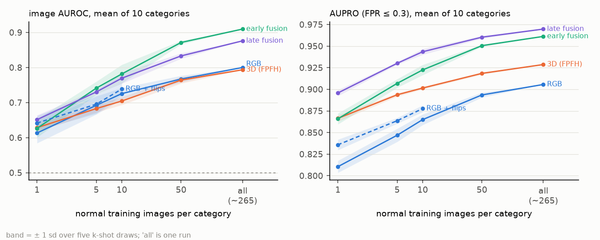
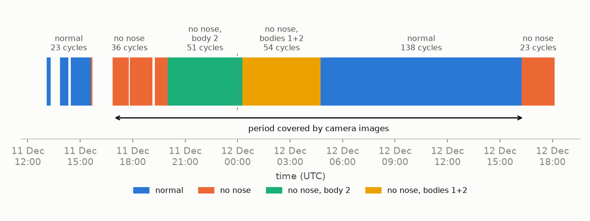

# FactoryLens

[](https://github.com/borabek/factorylens/actions/workflows/ci.yml)

Anomaly detection for industrial inspection using an RGB camera and a 3D sensor together, with a focus on what happens when one of the two sensors gets noisy or fails.

This is a work in progress (started October 2026). The research question, the dataset decision and the hypotheses are in [docs/research_plan.md](docs/research_plan.md).

## Where things are

**First results** (full tables in [docs/results.md](docs/results.md)), image AUROC averaged over the 10 categories:

| | this repo | published (Back to the Feature) |
|---|---|---|
| RGB only, PatchCore (5 seeds) | 0.799 ± 0.005 | 0.785 |
| 3D only, FPFH | 0.793 | 0.753 |
| RGB + FPFH concatenated, as in BTF (their preprocessing) | 0.801 | 0.873 |
| RGB + FPFH, halves balanced on the training data (their preprocessing) | **0.923** | |

- The two sensors fail in different places. RGB is near chance on potato (0.56), where 3D gets 0.95. 3D struggles on cable_gland and tire, where RGB is fine.
- Both single-sensor baselines reproduce. The published fusion does not: concatenating the two feature sets as BTF does lands *below* the better single sensor on 8 of 10 categories.
- The FPFH half of the joint features is 12–47 times wider than the RGB half, so the distances are almost entirely 3D. Rescaling it on the training data alone lifts the same fusion to 0.923, above both sensors on 9 of 10 categories and above the published number.

**How much normal data fusion needs** (990 runs: 4 detectors × k = 1, 5, 10, 50, all × 5 draws, this repo's preprocessing):



- On the full training set, balanced early fusion scores 0.910 and late fusion 0.876, against 0.800 for RGB and 0.793 for 3D. In 40 paired comparisons with a single sensor, fusion is never significantly worse.
- From 5 training images up, both fusions beat either sensor used everywhere. Against the harder baseline of picking the better sensor per category after the fact, late fusion matches it with all the data (0.876 vs 0.877) and early fusion beats it once there are 50 or more images (9 of 10 categories, Wilcoxon p = 0.04). Late fusion localises defects best (AUPRO 0.970).
- Early fusion is fragile with little data. At k ≤ 10 it drops more than 0.05 below the better sensor in a quarter of runs, sometimes below chance. On bagel this is because a few images don't hold the combinations of appearance and geometry a joint nearest neighbour needs. But that doesn't generalise: on cookie and peach, joint matching is clearly better than matching the two sensors separately, so a label-free coverage check can't pick the fusion in advance.

Findings from the data itself, each with the script that produces it:

- **The obvious multimodal dataset is confounded with time.** In Future Factories, almost every anomalous cycle in the camera period comes before every normal one, and elapsed time alone gives an AUROC of 0.986 (`scripts/ff/confound_check.py`). That is why the main study uses MVTec 3D-AD.
- **The 3D sensor is often blind exactly at the defect.** On bagel, cookie and peach, 12–13% of defect pixels have no 3D point (`scripts/eda_mvtec3d.py`). Only the camera can see those.
- **A standard preprocessing threshold deletes defects on thin objects.** BTF's 5 mm background cut removes 38% of the annotated defect pixels on dowel. This repo uses 2 mm (`scripts/check_background_removal.py`).
- **A sensor shortcut that flips sign across days.** In the FF robot data, R01's gripper load separates normal and missing-part cycles on day 1, but only because it drifts, and on day 2 the relationship reverses. R03 shows the real signature of a missing nose cone on both days (`scripts/ff/figures.py`).
- **A detector on every robot signal is worse than guessing.** Trained on day-1 normal cycles and tested on day 2, a forecast-residual detector over all four robots scores 0.33, because the drift outweighs the fault. The same detector on R03 alone scores 0.85, and 0.81 with the days swapped. Time of day scores 1.0 on both test days, so every result is checked against it (`scripts/ff/detectors.py`).
- **A perfect score from the clock, and the explanation that exposes it.** A classifier that only sees the time of day scores 1.000 on the test day, because both days ran the missing-part block in the afternoon. For a sensor-only classifier, impurity importance and SHAP both point at the drifting R01. Only permutation importance of held-out AUROC points at R03, the robot that handles the nose cone (`scripts/ff/explain.py`).
- **A logging gap that looked like drift.** R01's joint angles read exactly 0 for the whole day-1 normal block. Left in, they made a perfect label leak and a fake joint drift, which an earlier version of the data card reported. They are now masked when the data is loaded.



## Usage

```bash
uv run factorylens data check data/raw/mvtec3d --deep   # counts, file pairing, sizes
uv run factorylens data prepare data/raw/mvtec3d        # cached 224 px samples, ~1 min
uv run factorylens data kshot                           # rewrite configs/kshot.json
uv run factorylens ff blocks                            # FF label blocks and day split
uv run factorylens rgb run --category bagel             # PatchCore on one category
uv run factorylens results table results/rgb            # mean metrics over result files
uv run python scripts/make_results_tables.py            # regenerate docs/results.md
```

## Setup

Needs [uv](https://docs.astral.sh/uv/) and Python 3.11+.

```bash
make install   # creates .venv, installs pre-commit hooks
make check     # lint, type check, tests with coverage
```

## Data

Download instructions are in [docs/data.md](docs/data.md). The code downloads public datasets; nothing is redistributed here. The same page has counts, a data card and the figures.

- [MVTec 3D-AD](https://www.mvtec.com/company/research/datasets/mvtec-3d-ad) (CC BY-NC-SA 4.0), the main benchmark
- [Future Factories analog dataset](https://www.kaggle.com/datasets/ramyharik/ff-2023-12-12-analog-dataset) (CC BY-SA 4.0), used for a smaller sensor-only study

## License

Code is MIT. The datasets keep their own licences.
