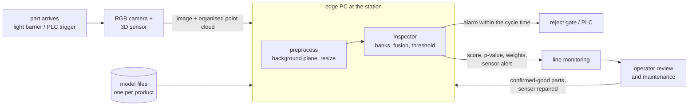

# How this would sit on a line

Everything in this repository runs on recorded public data. There is no camera, no 3D sensor and no PLC. The demo replays MVTec 3D-AD scans, and the timing numbers come from a laptop. This page describes how the pieces that do exist would fit into an inspection station. It also says which parts are missing and would have to be built.

## Data flow

1. **Trigger and capture.** A light barrier or the PLC triggers both sensors when a part is in position. One trigger has to produce an RGB image and an organised point cloud that line up pixel for pixel, as MVTec 3D-AD provides them. On real hardware this means a sensor that captures both together, or two sensors that have been registered to each other. The code assumes the alignment and does not check it.
2. **Preprocessing near the machine.** The background plane is removed from the point cloud and both inputs are resized to 224 px (`cache.prepare_sample`). This stays on the edge PC. A raw point cloud is 2–10 MB depending on the product (400 × 400 to 900 × 900 points, three float32 each), plus the image. The preprocessed part is about 0.8 MB, so sending raw scans to a server would waste most of the bandwidth.
3. **Inference on the edge PC.** `Inspector` holds both memory banks, the fusion statistics and the alarm threshold for one product. It answers one part at a time and keeps the reliability window as state. The reject decision has to arrive within the line's cycle time, which is why inference sits next to the machine rather than in a data centre. On the laptop a part takes about 150 ms end to end on the CPU ([latency.md](latency.md)).
4. **Reject signal.** `alarm` would go to the PLC, which drives the reject gate. Nothing here talks to a PLC. In practice that would be OPC UA or a digital output, and it needs a watchdog: if the inspector does not answer in time, the part should be rejected or held, not passed.
5. **Monitoring.** Every answer also carries the score, the conformal p-value, both sensor weights and `sensor_alert`. These go to the line's monitoring system as a time series. `GET /status` gives the current health of both sensors without inspecting a part.
6. **People in the loop.** An operator reviews alarms and sensor alerts. Their answers come back in two ways: confirmed-good parts at the start of a run tighten the alarm threshold, and `POST /reset` clears the reliability window after a sensor has been cleaned or replaced.

## Time budget

The reject gate has to know the answer before the part reaches it. What is left for inference is the cycle time minus capture, transfer and the PLC's own reaction, none of which exist here to measure. What the inspector itself needs, on the laptop CPU ([latency.md](latency.md)):

| line rate | time between parts | inspector, 10% coreset (148 ms) | inspector, 1% coreset (~115 ms) |
|---:|---:|---|---|
| 60 parts/min | 1000 ms | fits, with room for capture and transfer | fits |
| 300 parts/min | 200 ms | fits, but little room left | fits |
| 600 parts/min | 100 ms | too slow | too slow |

- A faster line needs either a second inspector per station working on alternate parts (each with its own window, since parts would no longer arrive in order at either), or a cheaper 3D stage. FPFH and preprocessing are 58% of the time and run on the CPU, so a GPU alone doesn't fix it (132 ms with the backbone on the laptop's GPU).
- The 90th percentile is about 10 ms above the median. A real budget should use a high percentile measured on the target hardware, under load, not a laptop median.
- The API returns each stage's time with every decision, and `GET /status` gives the median over the window, so a slowing station shows up in monitoring before it misses the gate.

## What the existing code covers

| role on a line | in this repository | missing for real use |
|---|---|---|
| fit a model per product | `factorylens fit`, one `.pt` file per product | a model registry with versions and who approved each one |
| inspect a part | `Inspector.inspect_raw`, `POST /inspect` | sensor drivers, trigger handling |
| decide reject / pass | `alarm` at a stated false alarm rate | PLC interface, timeout behaviour |
| sensor health | weights, `sensor_alert`, `GET /status` | alerts routed to maintenance |
| recalibrate | add confirmed-good parts to the calibration set (results.md, alarm thresholds) | a UI for the operator to confirm parts |
| reset after repair | `Inspector.reset()`, `POST /reset` | a record of who reset it and why |
| timing | `Inspector.timings`, `scripts/benchmark_latency.py` | measurement on the actual edge hardware |

## Design decisions and why

- **One inspector per product and station.** The banks, the fusion statistics and the threshold all describe one product under one sensor setup. Moving a model to another station with a different camera would need at least a new calibration set.
- **The window is state, so one worker per station.** The reliability weights of a part depend on the parts before it. The API therefore handles one request at a time. Running several workers behind a load balancer would give each its own window, and the weights would stop meaning anything. A station that needs more throughput would run its own process per lane.
- **Labels are never needed online.** Fitting uses normal parts only, and the health signals compare anomaly maps with the validation normals. So the station can start with a few hundred good parts and no defect library, which is the usual situation when a new product is introduced.
- **Edge, not cloud, for the decision; cloud is fine for the rest.** The reject decision needs a bounded response time and must keep working when the network is down. Monitoring, model fitting and storing flagged parts for review are not time-critical and can run elsewhere.
- **A stated false alarm rate, with its uncertainty.** The threshold is split-conformal on the validation normals. With about 30 calibration parts, the actual rate for a 10% target can land anywhere between 3% and 20% (results.md). A line should know that before trusting the number. `conformal.min_calibration` gives the number of good parts needed for a tighter guarantee.

## Failure modes on a line, and what the inspector does

| what happens | what the inspector sees | what it does |
|---|---|---|
| camera gets dirty, out of focus or noisy | the RGB map lifts everywhere | RGB weight drops after a median of 7 parts with the default window (16), `sensor_alert = "rgb"`, 3D carries the decision |
| 3D sensor loses points (reflective part, dust) | fewer valid points, FPFH map lifts | 3D weight drops, `sensor_alert = "3d"` |
| one sensor dies completely | constant or empty input | that sensor is switched off; late fusion alone would also cope, early fusion would not |
| something blocks part of the image | a local blob, like a defect | **not caught** by the default signal; the extent option catches it at a small cost on clean data |
| both sensors look off | both weights would be 0 | both kept at full weight, since switching both off leaves nothing to decide with; `health_rgb` and `health_3d` both show it, but `sensor_alert` stays empty, which is a gap |
| a new batch of material looks slightly different | normal parts score higher, false alarms rise | not detected as a sensor fault; the alarm rate in monitoring rises and the calibration set should be refreshed |

The last row is the main gap. The reliability signal separates "this sensor is broken" from "this part is defective". It does not separate either of those from a slow drift in what normal parts look like. Watching the alarm rate against its expected range is the simplest guard. A real deployment would also need a recalibration policy.

## Data handling

- Raw scans of normal parts do not need to leave the station. Flagged parts, with their anomaly maps, are worth keeping for review and for refitting later.
- A model file contains features of its training parts. For MVTec 3D-AD that puts it under the dataset's licence (CC BY-NC-SA 4.0), which is why no fitted model is published. A company's own parts would raise the same question: the model file is as sensitive as the images it was fitted on.
- Model files are loaded with `torch.load(weights_only=True)`, so a tampered file cannot run code on the edge PC.
