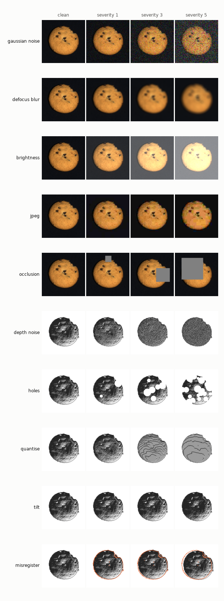

# FactoryLens-C

Corruptions of one sensor at a time, for testing whether an RGB + 3D detector notices that one of its inputs got worse. The RGB settings are the ones from ImageNet-C (Hendrycks & Dietterich, 2019) at 224 px. The 3D ones are new, and so is the misregistration between the two sensors.

Code: `src/factorylens/corruptions.py`. Every corruption is deterministic given a seed: the random state comes from (seed, corruption, severity, sample). Only code and seeds are shared, never corrupted copies of MVTec 3D-AD.

| corruption | sensor | what changes | severities 1–5 |
|---|---|---|---|
| gaussian noise | RGB | additive noise, σ as a share of 0–255 | 0.08, 0.12, 0.18, 0.26, 0.38 |
| defocus blur | RGB | disk kernel, radius in px | 3, 4, 6, 8, 10 |
| brightness | RGB | added to intensities in [0, 1] | 0.1, 0.2, 0.3, 0.4, 0.5 |
| jpeg | RGB | JPEG quality | 25, 18, 15, 10, 7 |
| occlusion | RGB | grey square on a random object pixel, share of the image | 2, 5, 10, 15, 25% |
| rgb missing | RGB | black image | one level |
| depth noise | 3D | Gaussian noise on z, σ | 0.25, 0.5, 1, 2, 4 mm |
| holes | 3D | round blobs of points removed until this share of the object is gone | 5, 10, 20, 30, 50% |
| quantise | 3D | z rounded to a step | 0.5, 1, 2, 3, 5 mm |
| tilt | 3D | rotation about the object's centroid, random horizontal axis | 1, 2, 4, 6, 10° |
| misregister | 3D vs RGB | xyz image shifted against the RGB image, random direction | 1, 2, 4, 6, 8 px |
| xyz missing | 3D | no points | one level |

Things to keep in mind when reading results:

- All corruptions act on the preprocessed arrays, after background removal. A real noisy sensor would also disturb the plane fit. Doing it this way keeps the preprocessing identical between clean and corrupted runs, so any change in score comes from the corruption alone.
- FPFH describes local shape through angles between normals, so a rigid tilt should barely change it. Tilt is in the suite as a check of that, not as a hard case.
- Ground-truth masks follow the RGB image. Under misregistration, the 3D anomaly map is displaced from the mask by the shift.
- Training data is never corrupted. `factorylens robustness` fits every model on the clean training set and scores clean and corrupted test sets.
