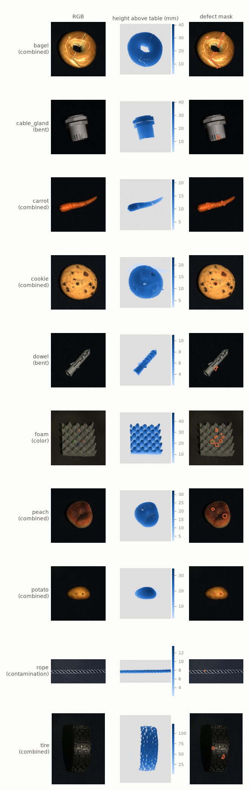
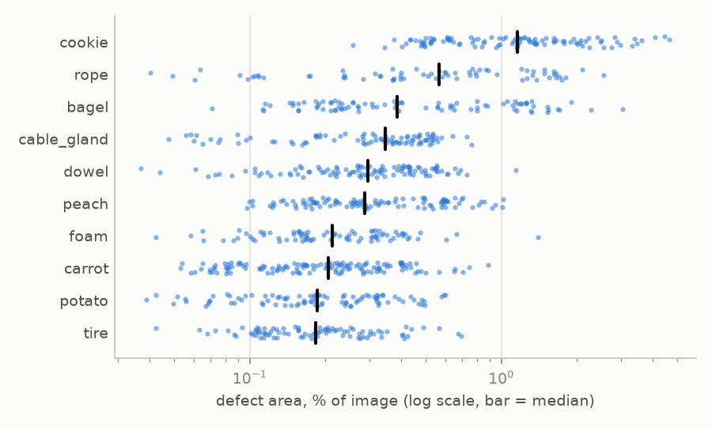
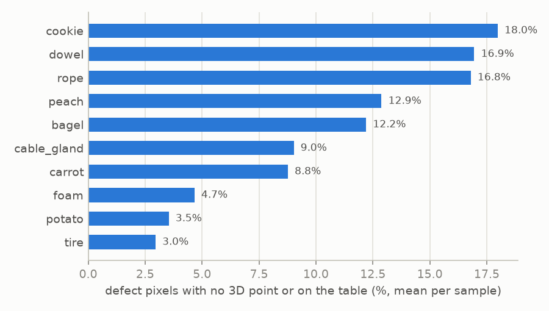
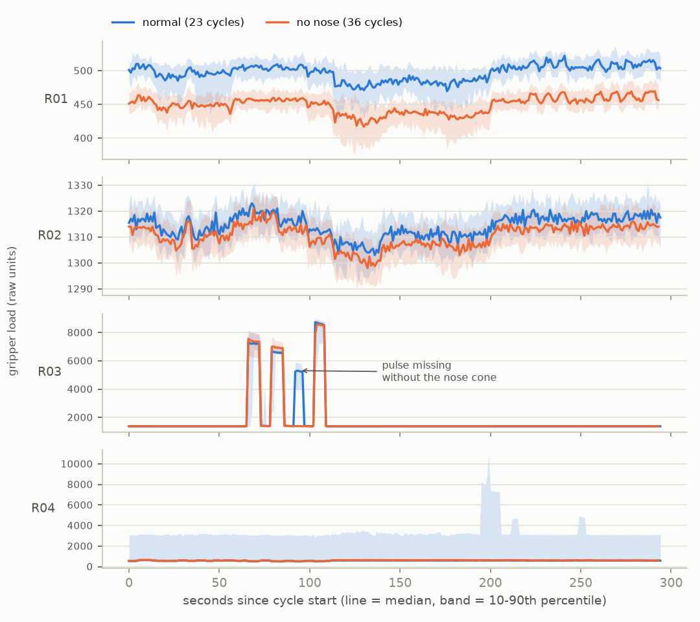
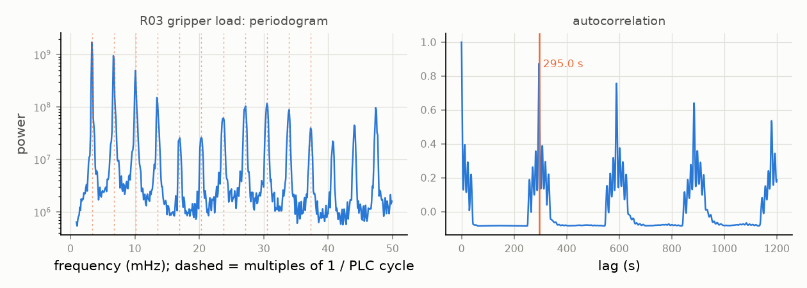
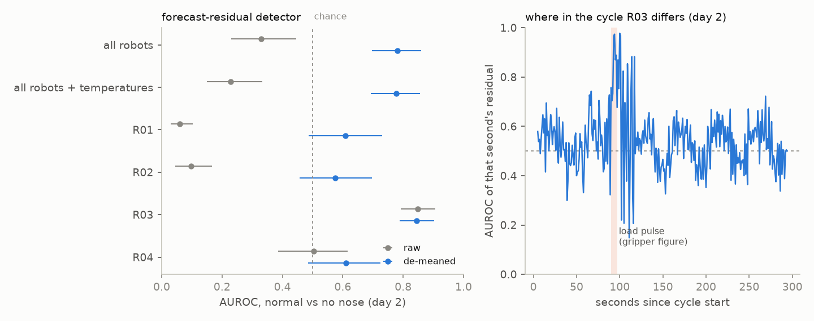
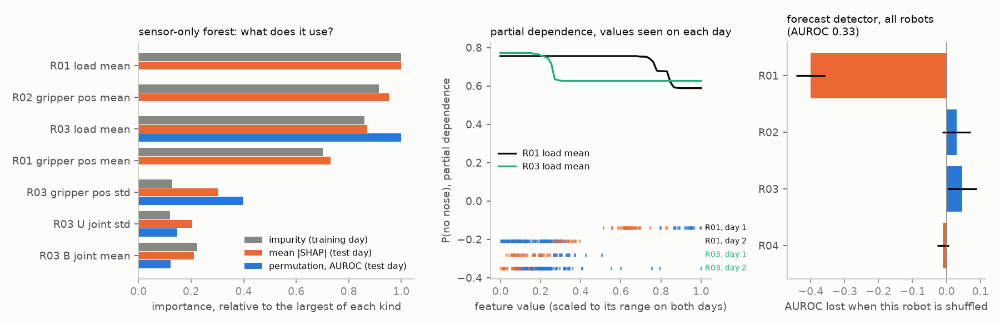

# Data

Nothing in this repo contains dataset files. Everything goes under `data/` (git-ignored) and is downloaded with the scripts below.

## MVTec 3D-AD (main benchmark)

10 object categories scanned with an industrial structured-light sensor. Each sample is an RGB image plus an `xyz` map (float32, metres) aligned pixel for pixel with it. Training and validation contain only defect-free samples. Test samples come with pixel masks, and the mask value encodes the defect type (`class_ids.json`).

| category | train | val | test | image size (W×H) | defect types |
|---|---|---|---|---|---|
| bagel | 244 | 22 | 110 | 800×800 | contamination, crack, hole, combined |
| cable_gland | 223 | 23 | 108 | 400×400 | bent, cut, hole, thread |
| carrot | 286 | 29 | 159 | 800×800 | contamination, crack, cut, hole, combined |
| cookie | 210 | 22 | 131 | 500×500 | contamination, crack, hole, combined |
| dowel | 288 | 34 | 130 | 400×400 | bent, contamination, cut, combined |
| foam | 236 | 27 | 100 | 900×900 | color, contamination, cut, combined |
| peach | 361 | 42 | 132 | 600×600 | contamination, cut, hole, combined |
| potato | 300 | 33 | 114 | 800×800 | contamination, cut, hole, combined |
| rope | 298 | 33 | 101 | 900×400 | contamination, cut, open |
| tire | 210 | 29 | 112 | 600×800 | contamination, cut, hole, combined |
| **total** | **2656** | **294** | **1197** | | |

Image sizes are from the first training sample of each category.

Pixels without a 3D point are stored as zeros, mostly background the sensor could not see. Averaged over all samples, valid coverage ranges from 61% (cable_gland) to 99% (rope).

### What the data looks like



Numbers from `scripts/eda_mvtec3d.py`, which writes one row per sample to `results/eda/mvtec3d_samples.csv`. Background removal uses the defaults: 2 mm plane threshold, then blobs under 0.02% of the image dropped.

| category | valid 3D points | object height (median) | defect area (median) | defect area (min) | defect px with no 3D point | defect px on the table |
|---|---|---|---|---|---|---|
| bagel | 83% | 39 mm | 0.39% | 0.07% | 12.1% | 0.3% |
| cable_gland | 61% | 38 mm | 0.35% | 0.05% | 9.0% | 0.1% |
| carrot | 98% | 17 mm | 0.20% | 0.05% | 8.6% | 0.4% |
| cookie | 90% | 20 mm | 1.16% | 0.26% | 13.3% | 4.8% |
| dowel | 99% | 9 mm | 0.30% | 0.04% | 3.9% | 13.0% |
| foam | 94% | 43 mm | 0.21% | 0.04% | 4.7% | 0.1% |
| peach | 84% | 34 mm | 0.29% | 0.10% | 12.9% | 0.1% |
| potato | 91% | 35 mm | 0.18% | 0.04% | 3.5% | 0.0% |
| rope | 99% | 12 mm | 0.56% | 0.04% | 10.0% | 7.2% |
| tire | 85% | 113 mm | 0.18% | 0.04% | 3.0% | 0.0% |

The last two columns are means over defective test samples (948 in total).

Things that matter later:

- **Defects are small.** The median defect covers 0.29% of the image, and about 10% of defective samples have under 0.1%. At a 224×224 input that median is roughly 145 pixels, and the smallest defects are a handful. Image-level AUROC can hide a lot here, which is why pixel-level metrics (AUPRO) are part of the plan.
- **The 3D sensor often misses exactly the defect.** On bagel, cookie and peach, 12–13% of defect pixels have no 3D point at all; cracks and holes are where structured light fails. A geometry-only model has nothing to score there, and the RGB image does.
- **Some defects sit off the object.** On dowel and rope, 7–13% of defect pixels end up as background: the table showing through a cut, or contamination lying next to the object. Plane removal drops them by design. This is the reason the threshold is 2 mm and not 5 mm (see `scripts/check_background_removal.py`).
- **Normal and defective test images were not taken under the same light.** Statistics that have nothing to do with the defect separate the two groups in several categories (`scripts/check_acquisition_confound.py`). On cable_gland the mean brightness of the background alone separates them perfectly: every defective image is darker. On cookie, the normal test images are brighter than both the training images and the defective ones (whole-image AUROC 0.98), and on peach the background reaches 0.94. A detector can therefore look better or worse than it is by reacting to global brightness. Corruptions that change brightness or compression (FactoryLens-C's brightness and JPEG) interact with it. I have not checked whether this has been reported before.
- **Object height varies 10×.** Dowel and rope are about 1 cm tall, tire over 11 cm. Any fixed 3D noise level in the corruption benchmark is relatively much harsher on thin objects, so severities will be expressed in millimetres and reported per category.





```bash
scripts/download_mvtec3d.sh data/raw/mvtec3d
uv run factorylens data check data/raw/mvtec3d --deep
uv run factorylens data prepare data/raw/mvtec3d   # ~1 min, 0.7 GB
```

`data prepare` writes every split at 224×224 to `data/processed/224px-<hash>/`:
- RGB is resized bilinearly.
- xyz and the masks are resized nearest-neighbour, after background removal at full resolution.
- `<hash>` comes from the preprocessing settings, so a changed threshold gets a fresh directory instead of stale arrays.

Reading bagel's 244 training samples from the cache takes 0.2 s, against 10 s from the raw files.

The full-archive link on the MVTec page was dead when I downloaded the data (2026-10-17), and so were the per-category links for carrot, cookie, foam and peach. I took those four from the Kaggle mirror [`gengchensun/mvtec-3d-ad`](https://www.kaggle.com/datasets/gengchensun/mvtec-3d-ad). The mirror's bagel folder is byte-identical to the official one, and the deep check passes on every category.

Licence: [CC BY-NC-SA 4.0](https://creativecommons.org/licenses/by-nc-sa/4.0/), so non-commercial use only. The figures above are derived from the dataset and fall under the same licence.

> Bergmann, Jin, Sattlegger, Steger. *The MVTec 3D-AD Dataset for Unsupervised 3D Anomaly Detection and Localization.* VISAPP 2022.

## Future Factories analog dataset (secondary study)

10 Hz signals from a rocket-assembly testbed at the University of South Carolina: four robots (gripper load and position, six joint angles each), conveyor drive temperatures and stoppers, safety I/O and a cycle counter. The data covers about 29 hours on 11–12 December 2023, and cycles are labelled as normal or by which parts were removed from the tray.

```bash
uvx kaggle datasets download ramyharik/ff-2023-12-12-analog-dataset --unzip -p data/raw/ff_analog
```

Licence: CC BY-SA 4.0.

See [research_plan.md](research_plan.md) for why the multimodal (image) version of this dataset is not used for the main comparison. The short version is this picture:


Anomalies were introduced in long blocks. Inside the window that has camera images, almost every anomalous cycle comes before every normal one. Normal and `NoNose` cycles do exist on both days, though, which allows a fair test: `factorylens ff blocks` trains on day 1 (23 normal, 36 NoNose) and tests on day 2 (138 normal, 23 NoNose).

What a missing nose cone looks like in the gripper signals (day 1 only):



- **R03** has a short load pulse around 90–97 s into each normal cycle that is simply absent without the nose cone. That is a direct physical signature of the missing part, and it holds on both days.
- **R01** sits lower for the *whole* cycle in the day-1 NoNose block, not at any particular event. Checked against day 2, this is drift: the R01 level keeps falling through the run, and on day 2 the NoNose cycles are actually *higher* than the normal ones. A detector that learned "low R01 = missing nose" on day 1 would get day 2 backwards.

| per-cycle value | day 1 normal | day 1 NoNose | day 2 normal | day 2 NoNose |
|---|---|---|---|---|
| R01 mean gripper load | 488 | 444 | 358 | 387 |
| R03 peak load, 88–98 s (median) | 7060 | 1407 | 6565 | 1401 |

This is the same kind of shortcut as in the image data, at a smaller scale. It is the first thing the explainability check on the sensor detector has to rule out.

Both figures come from `scripts/ff/figures.py`.

### Cleaning

Conveyor drives 2–4 report about 1% of their temperatures as corrupted values, from 1e-30 up to 1e38 and many negative. These look like misread registers. Drive 1 never leaves 68–94 °F, so `load_analog` treats temperatures outside 40–140 °F as missing. After that, all four drives sit between 68 and 93 °F.

R01's six joint angles read exactly 0 for the whole day-1 normal block, 22% of day 1, while its gripper load keeps changing. The arm was working and its angles were not logged. `load_analog` treats any row where all six joints of an arm read exactly 0 as missing for that arm. No other arm does this for more than 0.1% of a day. Left in, the zeros are a perfect label leak inside day 1: "R01 joints at zero" means normal.

### The cycle, without the PLC counter

The signals alone recover the cycle length. `scripts/ff/periods.py` bins each gripper-load and base-joint signal to 1 s and keeps the longest gap-free stretch (16.9 h). It then reads the period from the autocorrelation. All eight signals give 294.8–295.2 s, against a PLC median of 295.0 s, so the counter-based segmentation is not an artefact of the counter.



The periodogram is not the right tool for picking the period, although it confirms it. A short pulse once per cycle puts as much power in the harmonics as in the fundamental, and on synthetic pulses the tallest peak sits at half the period. The autocorrelation only peaks at whole cycles. `tests/test_ts.py` pins both behaviours down.

### What drifts

A straight-line fit to each signal's per-cycle mean over normal cycles (`results/analysis/ff_trends.csv`):

- R01's gripper load falls by 4.8 per hour (R² 0.59). This is the drift behind the R01 shortcut above. The other three gripper loads fall too, less cleanly (R² 0.28–0.42).
- All four conveyor drive temperatures rise by about 0.2 °F per hour (R² about 0.41). The room or the drives warm up over the run.
- No base joint drifts (R² ≤ 0.01).

<sub>Corrected on 2026-10-22. The first version said R01's base joint drifts by -0.155° per hour (R² 0.69). That trend was the logging dropout described under Cleaning: the zeros of the day-1 normal block pulled the fit. With them masked the slope is -0.005° per hour, R² 0.001.</sub>

Over the 29 hours these trends add up to 2–3 times the normal cycle-to-cycle spread. That is why anything that follows time can look like a defect detector on this data.

### Detecting a missing nose cone from the robot signals

`scripts/ff/detectors.py` turns every cycle into a 295 s × channels profile (1 s medians since the cycle started) and fits three detectors on normal cycles only (`factorylens/models/sensor.py`):

- **profile z-score**: mean distance from the normal profile, second by second, in normal standard deviations;
- **Isolation Forest** on 10 s averages;
- **forecast residual**: a ridge model predicts each second from the five before it and from the phase of the cycle (six Fourier pairs); the score is the mean squared error.

Each is trained on day-1 normal cycles and scored on day 2, and then the other way round. On each test day, normal and NoNose cycles form two contiguous blocks, so *time of day alone scores AUROC 1.0 in both directions*. A score here means nothing without checking that the detector is not just following drift. Two baselines check that: time of day, and a "level" detector that only sees each channel's mean over the cycle.

| channels | profiles | profile z | Isolation Forest | forecast | level |
|---|---|---|---|---|---|
| all four robots (26) | raw | 0.15 / 0.15 | 0.53 / 0.61 | 0.33 / 0.22 | 0.17 / 0.10 |
| all four robots (26) | de-meaned | 0.77 / 0.46 | 0.68 / 0.44 | 0.78 / 0.54 | |
| R01 (gripper only) | raw | 0.07 / 0.00 | 0.50 / 0.37 | 0.06 / 0.07 | 0.04 / 0.01 |
| R02 | raw | 0.12 / 0.13 | 0.34 / 0.16 | 0.10 / 0.13 | 0.14 / 0.04 |
| R02 | de-meaned | 0.66 / 0.47 | 0.65 / 0.35 | 0.57 / 0.43 | |
| **R03** | raw | 0.80 / 0.73 | 0.75 / 0.82 | **0.85 / 0.81** | 0.87 / 0.40 |
| **R03** | de-meaned | 0.86 / 0.61 | 0.76 / 0.62 | **0.85 / 0.81** | |
| R04 | raw | 0.56 / 0.38 | 0.53 / 0.50 | 0.50 / 0.73 | 0.43 / 0.50 |

AUROC, normal vs NoNose, *day 1 → day 2 / day 2 → day 1*. R01's joints are left out because they were not logged in the day-1 normal block (see Cleaning). Full table with bootstrap intervals and the temperature runs: `results/analysis/ff_detectors.csv`.



- **Pooling every robot is far worse than chance.** R01's gripper load drifts, R02 also differs between the blocks, and with every channel in one score that difference wins (0.15 both ways). In the day 2 → day 1 direction, the profile z-score on R01 alone ranks every normal cycle above every NoNose cycle. Removing each cycle's mean lifts the pooled forecast detector to 0.78, but only one way: the reverse gives 0.54.
- **R03 alone works in both directions.** The forecast detector scores 0.85 and 0.81 and is the only one that holds up when each cycle's mean is removed. The level baseline on R03 drops to 0.40 in the reverse direction, so it is the shape of R03's motion that carries the signal, not its level. Second by second (right panel), the residual separates the two classes best in the few seconds around the load pulse from the gripper figure, up to AUROC 0.97 for a single second; away from it, it sits near chance.
- **The R03 result is not a lucky setting.** `scripts/ff/forecast_grid.py` reruns the forecast detector over 60 settings (1–20 lags, 0–12 Fourier pairs, ridge alpha 0.1–10). What matters is the number of lags. With 5 or more, R03 scores 0.82–0.88 in both directions. With a single lag it drops to 0.74 and 0.56: one second of context is not enough to expect the five-second load pulse. The Fourier phase terms and alpha change the median by less than 0.01, so the "seasonal" part of the model adds nothing here. The reported setting (5 lags) was fixed before the first run. 10 lags would score a little higher, but choosing it now would be tuning on the test day. Pooling all robots stays at or below 0.58 in the reverse direction for every setting.
- R03 was picked from the day-1 gripper figure, before any day-2 cycle was scored. With only 23 NoNose cycles in the test day the intervals are wide (0.79–0.90 for R03 forecast).

### What the detectors rely on

The detectors above are unsupervised. To see what a model with labels would pick up, `scripts/ff/explain.py` trains random forests on day 1 (normal vs NoNose) with per-cycle features: mean and standard deviation of every logged robot channel, plus, for some models, two time features (hour of day, hours since the run started). It then tests them on day 2 and explains each one in three ways.

| features | AUROC on day 2 |
|---|---|
| time only | 1.000 |
| time + sensors | 1.000 |
| sensors | 0.970 |
| R03 only | 0.964 |

- **A model that only knows the clock is perfect on the test day.** On both days the NoNose block ran in the afternoon, after the normal block. "Later than 15:30" separates the classes on day 2 as well as on day 1, by coincidence of the schedule. No test score can tell this model apart from a real detector. Its explanation can: permutation importance puts all of it (0.51 AUROC) on hour of day.
- **The three explanations disagree, and the disagreement is the finding.** For the sensor-only forest:
  - *Impurity importance* is measured on the training day. It ranks R01's mean gripper load first, because on day 1 that feature separates the classes through drift.
  - *Mean |SHAP|* on day 2 also ranks R01 first. SHAP measures how much a feature moves the predictions. On day 2 every R01 value sits below the day-1 range, in the flat part of the partial dependence, so it shifts every prediction by the same amount without changing their order.
  - *Permutation importance of the day-2 AUROC* is the only one that asks whether a feature helps the detector. It gives R01 exactly 0 and puts R03's gripper load first (0.18), followed by R03's gripper position.
- **The pooled forecast detector is explained by its own sum.** Its score is a mean of per-channel squared residuals, so each robot's share is exact. R01 has 2 of 26 channels but 39% of the score. Shuffling R01's profiles across test cycles *raises* the AUROC by 0.40, while shuffling R03 lowers it. This is the drift from earlier, now measured as a contribution.



So feature attributions computed on training data, or attributions of the model output alone, would both have pointed at the drifting robot. Only the importance of held-out *performance* points at the robot that handles the missing part.

> Harik et al. *Analog and Multi-modal Manufacturing Datasets Acquired on the Future Factories Platform.* arXiv:2401.15544, 2024.
