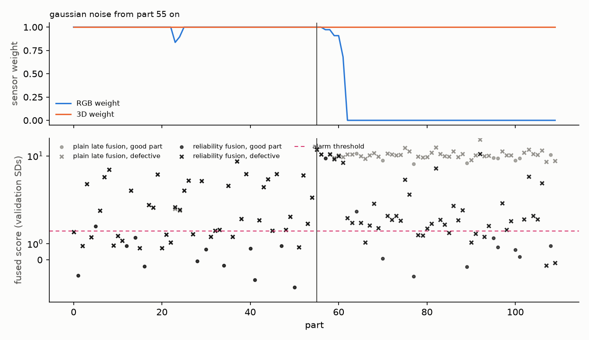

# Demo

A precomputed version is online at **[huggingface.co/spaces/bora2005/factorylens](https://huggingface.co/spaces/bora2005/factorylens)**. It shows four parts per product (one good, three defect types) under ten sensor states, and a mid-run failure for five corruptions per product. It was made with the same functions as the live app (`scripts/build_static_space.py`). The live Gradio app below needs a paid Hugging Face account to host, so it runs locally.

```bash
uv sync --extra demo --extra 3d
uv run factorylens fit --category bagel --half     # or any other category; -> models/
uv run factorylens demo                            # http://127.0.0.1:7860
```

A small Gradio app (`src/factorylens/demo.py`) around the fitted inspectors in `models/`, reading test parts from the prepared MVTec 3D-AD cache. It has two views.

## One part

Pick a product and a test part, and optionally break one sensor with a FactoryLens-C corruption at a chosen severity. The app shows:

- the RGB image and a shaded depth map as the sensors saw them;
- each sensor's anomaly map, and the fused map;
- the decision (alarm, p-value), each sensor's weight and health, and the ground truth.

Before the part is inspected, the reliability window is filled with 15 normal validation parts in the same sensor state, as on a line that has been running for a while. Judged with an empty window, a large real defect can look like a broken sensor. The first version did exactly that on a cracked bagel: RGB weight 0, health +7. With the window filled, both sensors count and the crack is flagged.

## A sensor fails

The test parts of one product come down the line in random order, and one sensor breaks halfway. The plot shows both sensor weights part by part. Below them it shows the fused score of plain late fusion (grey) and reliability fusion (black) against the same alarm threshold.



On bagel, with Gaussian noise on the camera from part 55 on, the RGB weight is down to 0 seven parts later, the median delay measured for a 16-part window (results.md). After the fault, with the same threshold:

| | false alarms on good parts | defective parts caught |
|---|---|---|
| plain late fusion | 100% | 100% |
| reliability fusion | 20% | 80% |

Plain late fusion alarms on everything, so the line would stop. Reliability fusion keeps working on the 3D sensor. The rendering is `scripts/demo_figure.py`.

## Data and licence

The app shows MVTec 3D-AD images and anomaly maps derived from them. The dataset is CC BY-NC-SA 4.0 (Bergmann et al., *The MVTec 3D-AD Dataset for Unsupervised 3D Anomaly Detection and Localization*, VISAPP 2022). The Hugging Face Space carries the same licence and attribution and is marked non-commercial; none of its images or models are in this repository.
