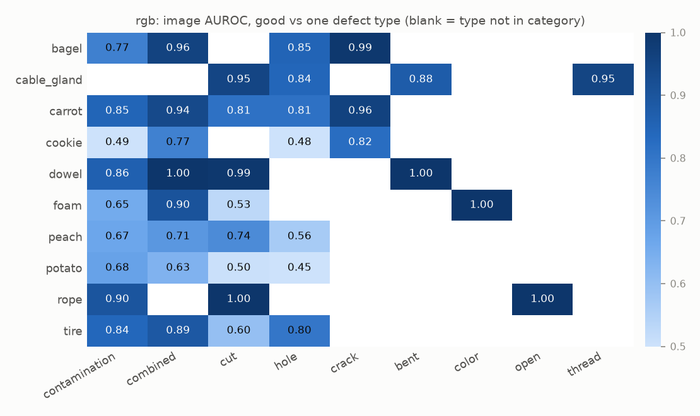
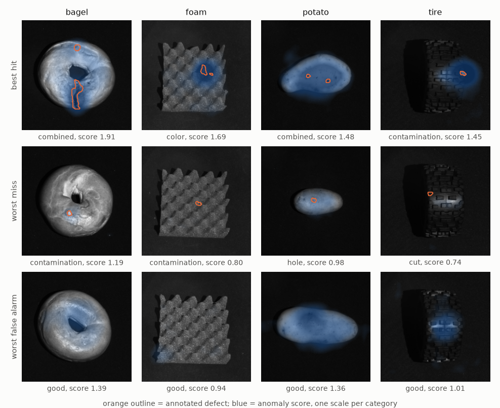
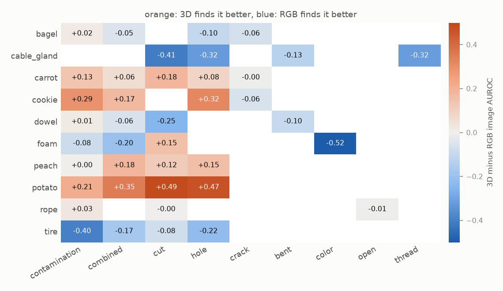
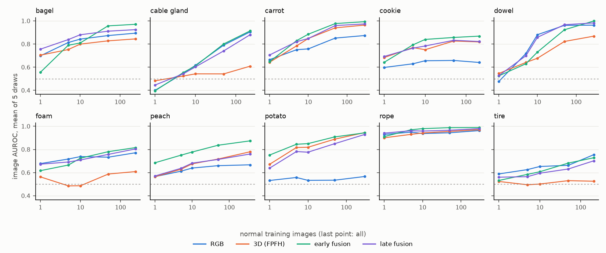

# Results

<!-- generated by scripts/make_results_tables.py, do not edit by hand -->

## RGB only (PatchCore)

Full training set, WideResNet-50 layer2 + layer3, 10% coreset, 224 px. BTF columns are the *RGB iNet* row of Back to the Feature, which uses the same recipe; their numbers are copied from the paper (`configs/reference/btf.json`). ± is the standard deviation over seeds; ms / image is scoring time on an M4 (MPS).

| category    | image AUROC       | 95% CI (seed 0)   |   BTF image | pixel AUROC   |   BTF pixel | AUPRO             |   BTF AUPRO |   ms / image |
|:------------|:------------------|:------------------|------------:|:--------------|------------:|:------------------|------------:|-------------:|
| bagel       | 0.892 ± 0.008     | [0.81, 0.95]      |       0.854 | 0.977         |       0.983 | 0.852 ± 0.002     |       0.898 |           40 |
| cable_gland | 0.911 ± 0.007     | [0.82, 0.96]      |       0.84  | 0.990         |       0.984 | 0.966 ± 0.000     |       0.948 |           52 |
| carrot      | 0.869 ± 0.009     | [0.81, 0.93]      |       0.824 | 0.989         |       0.98  | 0.956 ± 0.000     |       0.927 |           48 |
| cookie      | 0.645 ± 0.008     | [0.54, 0.75]      |       0.687 | 0.973         |       0.974 | 0.894 ± 0.001     |       0.872 |           40 |
| dowel       | 0.965 ± 0.004     | [0.93, 0.99]      |       0.974 | 0.986         |       0.985 | 0.932 ± 0.005     |       0.927 |           49 |
| foam        | 0.759 ± 0.020     | [0.67, 0.86]      |       0.716 | 0.927         |       0.836 | 0.765 ± 0.004     |       0.555 |           49 |
| peach       | 0.675 ± 0.009     | [0.55, 0.78]      |       0.713 | 0.970         |       0.976 | 0.883 ± 0.000     |       0.902 |           61 |
| potato      | 0.563 ± 0.009     | [0.41, 0.70]      |       0.593 | 0.983         |       0.982 | 0.942 ± 0.000     |       0.931 |           51 |
| rope        | 0.961 ± 0.003     | [0.93, 0.99]      |       0.92  | 0.993         |       0.989 | 0.936 ± 0.001     |       0.903 |           57 |
| tire        | 0.752 ± 0.009     | [0.65, 0.85]      |       0.724 | 0.981         |       0.975 | 0.923 ± 0.002     |       0.899 |           39 |
| **mean**    | **0.799 ± 0.005** |                   |       0.785 | **0.977**     |       0.966 | **0.905 ± 0.001** |       0.876 |           49 |

50 runs from commit 79ac4df, e49b5dd (clean checkout). CI: 1000 bootstrap resamples of the test images, stratified by label.

Reading the numbers:

- The reimplementation lands close to the published one. BTF's image AUROC falls inside our seed-0 95% CI on 9 of 10 categories, and the largest gap is 0.071 (cable_gland).
- Seeds only change which patch the coreset starts from. Across 5 seeds the mean image AUROC moves by ±0.005; the most seed-sensitive category is foam (±0.020).
- RGB alone is weakest on potato, cookie, peach (0.56, 0.65, 0.68). These are organic objects where colour and texture vary a lot between normal samples, which probably makes a dent or a cut look like normal variation to an ImageNet feature. The defect-type breakdown below makes this concrete.
- Localisation on foam is 0.21 AUPRO above BTF's number and is still unexplained; see the checks at the end of this page.

## What RGB misses, by defect type

Each defect type scored against the good test images of its category (`scripts/defect_breakdown.py`, seed 0).

| defect        |   categories |   images |   image_auroc |   aupro |
|:--------------|-------------:|---------:|--------------:|--------:|
| hole          |            7 |      174 |         0.685 |   0.93  |
| contamination |            9 |      223 |         0.746 |   0.901 |
| cut           |            8 |      195 |         0.765 |   0.899 |
| combined      |            8 |      174 |         0.85  |   0.903 |
| crack         |            3 |       75 |         0.924 |   0.93  |
| bent          |            2 |       48 |         0.938 |   0.987 |
| thread        |            1 |       22 |         0.95  |   0.982 |
| color         |            1 |       20 |         1     |   0.986 |
| open          |            1 |       17 |         1     |   0.986 |

Reading the numbers:

- Defects with a clear visual signature are easy (a new colour, an opened strand, a dark crack line): color 1.00, open 1.00, crack 0.92. Defects that mostly change shape are not: hole 0.68, cut 0.77. That is the gap the 3D sensor is supposed to fill.
- Contamination (0.75) sits in between: fine on most objects but weak on cookie (0.49), foam (0.66), peach (0.67), where foreign material looks like the object's own texture.
- The hardest single cases are potato hole (0.45), cookie hole (0.48), cookie contamination (0.49), potato cut (0.50), at or below chance.
- AUPRO stays high even where image AUROC is near chance (potato holes are localised well but the image score does not separate them). The image score is the single largest patch distance, so one unusual patch on a normal potato is enough to outscore a small hole.

Typical failure modes visible above (`scripts/rgb_examples.py`): on potato the whole object lights up for an unusually shaped but normal potato, and on tire the worst false alarm is a specular highlight on the tread.

## 3D only (FPFH)

Same memory bank as the RGB detector, on FPFH point-cloud features with BTF's settings (normals from 30 neighbours, FPFH from 100, 28x28 grid). Two preprocessings: this repo's (2 mm plane cut, tiny blobs dropped) and BTF's (5 mm cut, largest blob only). Seed 0.

|             |   FPFH image AUROC (ours, 2 mm) |   FPFH image AUROC (BTF preprocessing) |   FPFH image AUROC (paper) |   FPFH AUPRO (ours, 2 mm) |   FPFH AUPRO (BTF preprocessing) |   FPFH AUPRO (paper) |
|:------------|--------------------------------:|---------------------------------------:|---------------------------:|--------------------------:|---------------------------------:|---------------------:|
| bagel       |                           0.845 |                                  0.865 |                      0.82  |                     0.97  |                            0.972 |                0.972 |
| cable_gland |                           0.609 |                                  0.596 |                      0.533 |                     0.893 |                            0.888 |                0.849 |
| carrot      |                           0.964 |                                  0.964 |                      0.877 |                     0.991 |                            0.991 |                0.981 |
| cookie      |                           0.819 |                                  0.82  |                      0.769 |                     0.918 |                            0.913 |                0.939 |
| dowel       |                           0.868 |                                  0.875 |                      0.718 |                     0.94  |                            0.889 |                0.963 |
| foam        |                           0.605 |                                  0.686 |                      0.574 |                     0.741 |                            0.728 |                0.693 |
| peach       |                           0.78  |                                  0.782 |                      0.774 |                     0.982 |                            0.983 |                0.975 |
| potato      |                           0.946 |                                  0.945 |                      0.895 |                     0.992 |                            0.992 |                0.981 |
| rope        |                           0.971 |                                  0.951 |                      0.99  |                     0.906 |                            0.901 |                0.98  |
| tire        |                           0.521 |                                  0.688 |                      0.582 |                     0.95  |                            0.953 |                0.949 |
| **mean**    |                           0.793 |                                  0.817 |                      0.753 |                     0.928 |                            0.921 |                0.928 |

50 runs from commit 401d938, 5a7f07c (clean checkout).

Reading the numbers:

- Geometry and colour fail in different places. FPFH beats RGB by the most on potato (+0.38), cookie (+0.17), peach (+0.10), and loses by the most on cable_gland (-0.30), tire (-0.23), foam (-0.15). Potato, where RGB was near chance, is one of the easiest categories for 3D.
- Our FPFH is above the published one on average (0.793 and 0.817 vs 0.753 image AUROC). The biggest single gap is dowel (0.868 vs 0.718).

## Which sensor finds which defect

RGB and 3D side by side per category and defect type, 3D minus RGB image AUROC (`scripts/compare_sensors.py`, seed 0, this repo's preprocessing).

Reading the numbers:

- The object decides more than the defect does. Category alone explains 73% of the variation in the difference, defect type alone 22%.
- 3D wins on potato (+0.38), cookie (+0.18), peach (+0.11), carrot (+0.09). These are organic objects whose colour and texture vary from one normal sample to the next, so the camera's notion of normal is wide and a dent hides inside it. RGB wins on cable_gland (-0.29), tire (-0.22), foam (-0.16), which are manufactured parts with a consistent look; cable gland also has the lowest 3D coverage in the dataset (61% of pixels, see docs/data.md).
- This corrects the day-4 guess that holes and cuts are where 3D helps. Averaged over categories they only move by hole +0.05, cut +0.02; on a potato 3D finds them far better, on a tire or a cable gland far worse.
- The two single-instance types are the cleanest cases: foam's colour defect is invisible to geometry, and cable gland's damaged thread is probably too fine for the 3D scan to resolve.

## Reproducing Back to the Feature

All three models run the way BTF runs them: their preprocessing (5 mm cut, largest blob, RGB blacked out where points were removed), no padding in the 3x3 average, all 1536 RGB channels, PatchCore's reweighted image score. Image AUROC, seed 0.

|             |   RGB, ours |   RGB, paper |   FPFH, ours |   FPFH, paper |   BTF (RGB + FPFH), ours |   BTF (RGB + FPFH), paper |
|:------------|------------:|-------------:|-------------:|--------------:|-------------------------:|--------------------------:|
| bagel       |       0.885 |        0.854 |        0.865 |         0.82  |                    0.841 |                     0.938 |
| cable_gland |       0.877 |        0.84  |        0.596 |         0.533 |                    0.569 |                     0.765 |
| carrot      |       0.889 |        0.824 |        0.964 |         0.877 |                    0.965 |                     0.972 |
| cookie      |       0.766 |        0.687 |        0.82  |         0.769 |                    0.816 |                     0.888 |
| dowel       |       0.953 |        0.974 |        0.875 |         0.718 |                    0.875 |                     0.96  |
| foam        |       0.832 |        0.716 |        0.686 |         0.574 |                    0.643 |                     0.664 |
| peach       |       0.782 |        0.713 |        0.782 |         0.774 |                    0.776 |                     0.904 |
| potato      |       0.614 |        0.593 |        0.945 |         0.895 |                    0.939 |                     0.929 |
| rope        |       0.941 |        0.92  |        0.951 |         0.99  |                    0.951 |                     0.982 |
| tire        |       0.737 |        0.724 |        0.688 |         0.582 |                    0.64  |                     0.726 |
| **mean**    |       0.828 |        0.785 |        0.817 |         0.753 |                    0.801 |                     0.873 |

10 runs from commit 401d938 (clean checkout).

Reading the numbers:

- Each half reproduces, and then some: RGB 0.828 vs 0.785, FPFH 0.817 vs 0.753.
- The combination does not. BTF reaches 0.801 here against 0.873 in the paper, and it is below the better single modality on 8 of 10 categories. Fusing made things worse.
- The reason is scale. Over the training patches the FPFH half is 12-47 times wider than the RGB half (`scripts/btf_feature_scale.py`), so at least 99.4% of a typical squared distance is FPFH. Concatenation without rescaling is effectively FPFH alone, and the per-category numbers track FPFH closely. The paper's result must come from a setup where the two halves were closer in size or weighted differently; I have not found which (FPFH magnitudes depend on the library version, for one). Either way the method is sensitive to something that should not matter.
- That is the starting point for the fusion experiments: rescale or score the two modalities separately before combining them.

## Balancing the two halves

The test for the explanation above: same BTF model, same preprocessing, but the FPFH half is scaled before concatenation. *balanced* picks the factor per category on the training patches so that both halves have the same spread; nothing from the test set is used. Image AUROC, seed 0.

| category    |   RGB |   FPFH |   weight 1 (BTF) |   weight 0.1 |   weight 0.03 |   balanced |   paper BTF |
|:------------|------:|-------:|-----------------:|-------------:|--------------:|-----------:|------------:|
| bagel       | 0.885 |  0.865 |            0.841 |        0.941 |         0.975 |      0.971 |       0.938 |
| cable_gland | 0.877 |  0.596 |            0.569 |        0.852 |         0.893 |      0.894 |       0.765 |
| carrot      | 0.889 |  0.964 |            0.965 |        0.99  |         0.983 |      0.99  |       0.972 |
| cookie      | 0.766 |  0.82  |            0.816 |        0.94  |         0.942 |      0.92  |       0.888 |
| dowel       | 0.953 |  0.875 |            0.875 |        0.955 |         0.969 |      0.954 |       0.96  |
| foam        | 0.832 |  0.686 |            0.643 |        0.746 |         0.838 |      0.769 |       0.664 |
| peach       | 0.782 |  0.782 |            0.776 |        0.896 |         0.933 |      0.918 |       0.904 |
| potato      | 0.614 |  0.945 |            0.939 |        0.957 |         0.943 |      0.949 |       0.929 |
| rope        | 0.941 |  0.951 |            0.951 |        0.973 |         0.957 |      0.974 |       0.982 |
| tire        | 0.737 |  0.688 |            0.64  |        0.869 |         0.867 |      0.895 |       0.726 |
| **mean**    | 0.828 |  0.817 |            0.801 |        0.912 |         0.93  |      0.923 |       0.873 |

10 runs from commit 5a7f07c (clean checkout).

Reading the numbers:

- Balanced, the same concatenation reaches 0.923, up from 0.801, and is above both single sensors on 9 of 10 categories. It is also above the paper's 0.873 (AUPRO 0.960).
- So the explanation holds causally, not just as a correlation: change nothing but the relative scale of the two halves and the fusion goes from worse than either sensor to better than both.
- The fitted factors range from 0.021 to 0.080, so FPFH is shrunk 12-47x depending on the category.
- A fixed factor of 0.03 does about as well on average (0.930), 0.1 a little worse (0.912). Taking whichever fixed factor scores best here would be choosing it on the test set; the balanced factor is decided from the training data before any test image is seen, so it is the number to quote.
- With this repo's preprocessing instead of BTF's, balanced fusion gives 0.910.

## Fusion and training-set size

`factorylens sweep`: the same RGB and FPFH patch features in four detectors, with this repo's preprocessing. *early*: the two halves concatenated, FPFH scaled per run so that both have the same spread on the training patches. *late*: one memory bank per sensor, each score standardised on the validation normals, then summed. Image AUROC on the full training set, seed 0; ✓ = better than both single sensors, paired bootstrap 95% interval above zero.

| category    | RGB   | FPFH   | better sensor   | early fusion   | late fusion   |
|:------------|:------|:-------|:----------------|:---------------|:--------------|
| bagel       | 0.894 | 0.845  | 0.894           | 0.971 ✓        | 0.925         |
| cable_gland | 0.905 | 0.609  | 0.905           | 0.914          | 0.880         |
| carrot      | 0.874 | 0.964  | 0.964           | 0.993 ✓        | 0.974         |
| cookie      | 0.641 | 0.819  | 0.819           | 0.869          | 0.822         |
| dowel       | 0.963 | 0.868  | 0.963           | 0.999 ✓        | 0.983 ✓       |
| foam        | 0.771 | 0.609  | 0.771           | 0.816          | 0.804         |
| peach       | 0.667 | 0.780  | 0.780           | 0.874 ✓        | 0.761         |
| potato      | 0.566 | 0.946  | 0.946           | 0.943          | 0.929         |
| rope        | 0.963 | 0.971  | 0.971           | 0.989          | 0.980         |
| tire        | 0.755 | 0.526  | 0.755           | 0.728          | 0.702         |
| **mean**    | 0.800 | 0.793  | 0.877           | 0.910          | 0.876         |
| **AUPRO**   | 0.906 | 0.929  |                 | 0.961          | 0.970         |

990 runs from commit e09149b (clean checkout), all k and draws.

- Early fusion is better than both sensors on 4 of 10 categories by the paired test, late fusion on 1. Neither is significantly worse than a single sensor on any category (0 losses in 40 comparisons).
- Early beats late on image AUROC (mean +0.034, significant on 4 categories, never worse), but late fusion localises better (AUPRO 0.970 vs 0.961).

Mean image AUROC over the 10 categories for k normal training images, ± the spread over five k-shot draws (`configs/kshot.json`):

| model        | 1             | 5             | 10            | 50            | all   |
|:-------------|:--------------|:--------------|:--------------|:--------------|:------|
| RGB          | 0.613 ± 0.029 | 0.692 ± 0.026 | 0.726 ± 0.017 | 0.767 ± 0.009 | 0.800 |
| FPFH         | 0.628 ± 0.011 | 0.683 ± 0.011 | 0.705 ± 0.011 | 0.764 ± 0.009 | 0.793 |
| early fusion | 0.626 ± 0.026 | 0.741 ± 0.019 | 0.782 ± 0.026 | 0.871 ± 0.005 | 0.909 |
| late fusion  | 0.651 ± 0.013 | 0.730 ± 0.006 | 0.769 ± 0.015 | 0.833 ± 0.008 | 0.876 |
| RGB + flips  | 0.641 ± 0.021 | 0.695 ± 0.027 | 0.739 ± 0.017 |               |       |

Per category, which is where the averages come from:

- Against either sensor used on every category, both fusions are ahead from five images up. With one image, late fusion is the best model and early fusion is no better than FPFH.
- The harder baseline is *better sensor*: whichever of RGB and FPFH scores higher on that category, which is only known after seeing the test results. On the full training set late fusion matches it (0.876 vs 0.877) without having to know which sensor to trust, and early fusion is above it on 8 of 10 categories. With ten images or fewer neither fusion beats it: comparing category means (the five draws share images, so they are averaged first), early fusion is +0.002 at k = 10 (Wilcoxon p = 0.92). At k = 50 it pulls ahead, +0.035 (p = 0.04, better on 9 of 10). All tests: `results/analysis/sweep_kshot_tests.csv`.
- Early fusion is fragile with little data: at k ≤ 10 it falls more than 0.05 below the better single sensor in 25% of runs, late fusion in 13%. Its spread over draws is about twice late fusion's.
- Why it fails is not one thing. `scripts/early_fusion_coverage.py` matches each test patch once against the joint bank and once against each sensor's bank, and measures the *coverage gap*: how much farther the joint neighbour is than the two separate ones. On bagel it explains the failures: with one image, matching the halves separately scores 0.19 higher than joint matching, and the gap on the validation normals has Spearman -0.82 with early fusion's AUROC over the 20 draws. A few bagels do not contain the combinations of colour and shape the joint space needs.
- It does not generalise. Within a category the same correlation ranges from -0.82 (bagel) to +0.82 (cable_gland). On cookie and peach, joint matching is *better* than separate by 0.11-0.14 at k = 10: there, which shape goes with which colour is itself the information that finds defects. So the gap cannot be used to choose between early and late fusion in advance, which was the plan. 200 runs from commit fff4be0, clean checkout.
- Flips and rotations of the training images help RGB a little at k = 1 and 10 and not at 5. They do not close the gap to either fusion.

## Robustness: one sensor corrupted (FactoryLens-C)

Every model is fitted on clean training data; only the test set is corrupted, one sensor at a time ([corruptions.md](corruptions.md)). Image AUROC averaged over the five severities and 10 categories. *healthy sensor* is the clean score of the sensor that was not corrupted, i.e. what a system that knew which sensor broke could get by switching it off.

|                      | healthy sensor   | RGB   | FPFH   | early fusion   | late fusion   |
|:---------------------|:-----------------|:------|:-------|:---------------|:--------------|
| brightness (RGB)     | 0.793            | 0.709 | 0.793  | 0.846          | 0.813         |
| defocus blur (RGB)   | 0.793            | 0.551 | 0.793  | 0.757          | 0.764         |
| gaussian noise (RGB) | 0.793            | 0.555 | 0.793  | 0.760          | 0.776         |
| jpeg (RGB)           | 0.793            | 0.531 | 0.793  | 0.684          | 0.710         |
| occlusion (RGB)      | 0.793            | 0.460 | 0.793  | 0.573          | 0.726         |
| rgb missing (RGB)    | 0.793            | 0.500 | 0.793  | 0.639          | 0.793         |
| depth noise (3D)     | 0.800            | 0.800 | 0.551  | 0.629          | 0.795         |
| holes (3D)           | 0.800            | 0.800 | 0.689  | 0.571          | 0.834         |
| misregister (3D)     | 0.800            | 0.800 | 0.816  | 0.900          | 0.887         |
| quantise (3D)        | 0.800            | 0.800 | 0.581  | 0.666          | 0.793         |
| tilt (3D)            | 0.800            | 0.800 | 0.795  | 0.906          | 0.876         |
| xyz missing (3D)     | 0.800            | 0.800 | 0.500  | 0.466          | 0.800         |
| **clean**            |                  | 0.800 | 0.793  | 0.909          | 0.876         |

2120 runs from commit 9175185 (clean checkout).

- Early fusion is the best model on clean data (0.909) and the most fragile one. It ends up below the healthy sensor on 9 of 12 corruptions: 0.710 on average when the RGB image is corrupted (FPFH alone: 0.793), 0.690 when the point cloud is (RGB alone: 0.800). With no 3D at all it scores 0.466.
- Late fusion degrades more gracefully (0.764 and 0.831) and loses a whole missing sensor without cost: a dead sensor gives every image the same score, so the sum is ranked by the other one. A *noisy* sensor is different. Its scores vary from image to image without meaning anything, and late fusion still falls below the healthy sensor on 4 corruptions, mostly on the RGB side.
- That gap, between what late fusion gets and what switching off the broken sensor would get, is what a reliability-aware fusion has to close without being told which sensor broke.
- The JPEG and brightness rows need care. They change global image statistics, and in several categories those statistics already separate normal from defective test images before any detector looks: on cable_gland the mean brightness of the *background* alone gives AUROC 1.00, on cookie the whole image 0.98, on peach the background 0.94 (`scripts/check_acquisition_confound.py`, AUROC folded so that 0.5 means no separation). JPEG error follows brightness and texture, so it can push a detector's scores along that difference or against it; single categories swing between 0 and 1 across JPEG severities for that reason, not because of the code.
- The clean row reproduces the sweep's full-data runs to four decimals (0.9095, 0.8759), through a separate code path.
- Tilt barely changes FPFH, as expected for a rotation-invariant descriptor, and a shift of up to 8 px is at most one 8 px patch of the 28x28 feature grid, so misregistration costs little at this resolution.

## Which backbone layers (RGB)

Same detector, every layer combination on the same 28x28 patch grid (`scripts/run_layer_ablation.py`), full training set.

| layers               |   categories |   image_auroc |   pixel_auroc |   aupro |
|:---------------------|-------------:|--------------:|--------------:|--------:|
| layer1               |           10 |         0.788 |         0.985 |   0.945 |
| layer2               |           10 |         0.806 |         0.981 |   0.926 |
| layer3               |           10 |         0.77  |         0.964 |   0.854 |
| layer1+layer2        |           10 |         0.815 |         0.985 |   0.941 |
| layer2+layer3        |           10 |         0.8   |         0.977 |   0.906 |
| layer1+layer2+layer3 |           10 |         0.818 |         0.981 |   0.923 |

Image AUROC per category:

| category    |   layer1 |   layer2 |   layer3 |   layer1+layer2 |   layer2+layer3 |   layer1+layer2+layer3 |
|:------------|---------:|---------:|---------:|----------------:|----------------:|-----------------------:|
| bagel       |    0.873 |    0.865 |    0.899 |           0.9   |           0.894 |                  0.937 |
| cable_gland |    0.875 |    0.946 |    0.872 |           0.952 |           0.905 |                  0.925 |
| carrot      |    0.826 |    0.916 |    0.794 |           0.903 |           0.874 |                  0.911 |
| cookie      |    0.512 |    0.682 |    0.644 |           0.661 |           0.641 |                  0.628 |
| dowel       |    0.991 |    0.966 |    0.912 |           0.989 |           0.963 |                  0.976 |
| foam        |    0.789 |    0.719 |    0.734 |           0.707 |           0.771 |                  0.786 |
| peach       |    0.692 |    0.686 |    0.691 |           0.72  |           0.667 |                  0.697 |
| potato      |    0.709 |    0.567 |    0.532 |           0.622 |           0.566 |                  0.609 |
| rope        |    0.94  |    0.944 |    0.95  |           0.96  |           0.963 |                  0.967 |
| tire        |    0.67  |    0.774 |    0.674 |           0.741 |           0.755 |                  0.746 |

60 runs from commit 79ac4df (clean checkout).

Reading the numbers:

- Mean image AUROC only moves by 0.048 across all six choices. Best is layer1+layer2+layer3 (0.818), against 0.800 for the default layer2+layer3. That is smaller than a typical per-category confidence interval.
- For localisation the shallow features win: layer1 has the best AUPRO (0.945). layer3 alone is clearly worst on both, which matches the per-layer distance maps in `docs/figures/layer_maps.png`.
- The default stays layer2+layer3. MVTec 3D-AD has no validation split with defects, so picking the layers that look best here would mean tuning on the test set and every later number would be optimistic. This table is an analysis, not a selection step.

## Checks

**AUPRO against the official evaluation code.** The MVTec 3D-AD / BTF code samples 100 thresholds evenly in FPR and counts 8-connected regions; ours uses every threshold and 4-connected regions (`scripts/check_aupro_against_official.py`, seed 0 maps).

|          |   bagel |   cable_gland |   carrot |   cookie |   dowel |   foam |   peach |   potato |   rope |   tire |
|:---------|--------:|--------------:|---------:|---------:|--------:|-------:|--------:|---------:|-------:|-------:|
| ours     |   0.851 |         0.967 |    0.956 |    0.894 |   0.938 |  0.764 |   0.883 |    0.942 |  0.937 |  0.923 |
| official |   0.854 |         0.963 |    0.954 |    0.891 |   0.932 |  0.76  |   0.881 |    0.94  |  0.933 |  0.917 |

The mean differs by 0.003, so the metric is not where any difference to published numbers comes from.

**Foam and the Gaussian blur.** Rerunning foam with blur sigma 0.0, 2.0, 4.0, 8.0 moves AUPRO by only 0.011 (0.756-0.767). With the metric and the blur ruled out, the remaining differences to BTF's pipeline are the RGB resize (they use bicubic) and their preprocessing; foam's 0.21 gap stays an open question.
